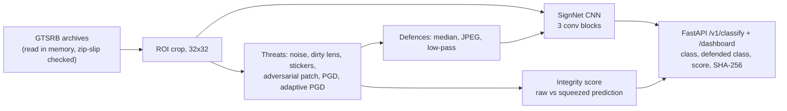
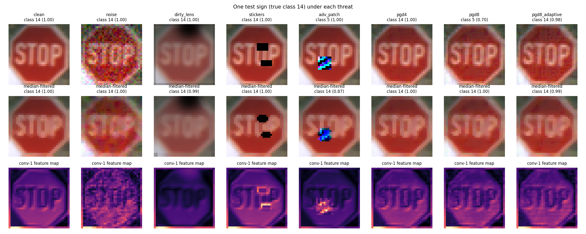

# infra-vision-adversarial-defense

**How much can you trust automated traffic-sign recognition when the camera is dirty or someone has put a
sticker on the sign?** A CNN trained on the real GTSRB traffic-sign dataset is tested against sensor noise,
lens dirt, random stickers, an optimised adversarial patch and digital attacks, including one that knows the
defence. Input defences (median filter, JPEG, Fourier low-pass) and a feature-squeezing integrity score are
evaluated honestly. A FastAPI service with a dashboard shows raw vs defended input, feature maps and the
integrity score, with a SHA-256 of every input for provenance.

**Headline (98.4% clean accuracy on 12,630 real test images):**

* **Ordinary dirt matters as much as attacks.** A dirty lens cost 16 points of accuracy and random stickers 22,
  before any adversary is involved.
* **An optimised 7×7-pixel patch (5% of the image) cut accuracy to 61.6%;** a median filter recovered it to
  75.8%. Digital attacks were far stronger: 14.8% at ε = 8/255, and only 30.6% with the median filter.
* **Defences that help one threat hurt another.** The median filter that helps against patches made dirty-lens
  and sticker images worse (82.5% → 77.6%, 76.0% → 72.9%).
* **The integrity score is a weak, honest signal:** it flagged 39-55% of attacked images but also 10.3% of
  clean test images (the target was 5%), and it flags strong attacks *less* than weak ones.

---

## 1. Problem formulation

Agencies increasingly inventory and inspect assets from vehicle and drone imagery: sign condition and type,
pavement distress, work-zone devices. Those pipelines inherit the weaknesses of image classifiers: dirty
lenses, occlusion, and deliberately crafted patterns that look harmless to people. For asset-management
data, the question is not only "is the prediction right" but "can I tell when it might not be", which is what
an integrity score and input provenance are for.

| Bar | Here |
|---|---|
| **Infrastructure / transportation** | Real roadside sign images (GTSRB, 43 classes), realistic degradations (sensor noise, lens dirt, stickers), physical-style patch |
| **ML security** | PGD (white-box), universal adversarial patch with expectation over transformation, BPDA adaptive attack against the defence, feature-squeezing detection |
| **Systems** | Safe archive handling (zip-slip check), FastAPI classification with input hash and model version, HTML dashboard with feature maps, Docker |

---

## 2. Architecture



---

## 3. Methodology

**Data.** GTSRB (Stallkamp et al., 2012): the "Training_fixed" archive with 26,640 images (90% train, 10%
validation) and the official test set of 12,630 images. Each image is cropped to its annotated sign region
and resized to 32×32.

**Model.** Three conv blocks (32-64-128 channels, batch norm, max pooling) and a two-layer head with dropout,
trained for 8 epochs with brightness/contrast jitter and small shifts (7.9 min on CPU).

**Threats** (on 3,000 random test images):

| Threat | Definition |
|---|---|
| noise | Gaussian sensor noise, sd 0.08 |
| dirty_lens | 3×3 blur, 40% haze, three random dark smudges |
| stickers | two random black or white rectangles, about 8% of the image |
| adv_patch | one universal 7×7 patch optimised against the model over random images and positions, pasted at a random spot |
| pgd4, pgd8 | L∞ PGD, 10 steps, ε = 4/255 and 8/255 (digital white-box upper bound) |
| pgd8_adaptive | PGD through the median filter with BPDA (identity gradient), i.e. an attacker who knows the defence |

**Defences.** 3×3 median filter, JPEG re-encoding at quality 50, Fourier low-pass (central 20×20
frequencies). **Integrity score** (feature squeezing, Xu et al. 2018): the L1 distance between the softmax on
the raw image and on a squeezed copy (4-bit colour plus median), with the threshold set for 5% false alarms on
clean validation images.

---

## 4. Results ([`results/gtsrb/RESULTS.md`](results/gtsrb/RESULTS.md))



**Accuracy (%) by threat and defence; last column: share flagged by the integrity score.**

| Threat | None | Median | JPEG | Low-pass | Flagged |
|---|---|---|---|---|---|
| clean | **98.4** | 97.9 | 97.4 | 98.3 | 10.3 |
| noise | 89.5 | **91.2** | 86.2 | 90.5 | 29.5 |
| dirty_lens | **82.5** | 77.6 | 73.5 | 82.0 | 49.2 |
| stickers | **76.0** | 72.9 | 71.3 | 74.4 | 50.2 |
| adv_patch | 61.6 | **75.8** | 68.8 | 68.3 | 54.7 |
| pgd4 | 41.2 | 56.1 | **59.7** | 48.9 | 51.5 |
| pgd8 | 14.8 | 30.6 | **31.1** | 22.4 | 39.2 |
| pgd8_adaptive (vs median) | - | 25.8 | - | - | 31.1 |

**Engineering reading.**

* **There is no free defence.** Every preprocessing step costs some clean accuracy, and the one that helps most
  against patches (median) hurts dirty-lens and sticker images, which are far more common in the field. A
  deployment should pick defences by the threats it actually expects.
* **The adaptive attack shows how fragile the gain is.** Knowing the median filter, the attacker took defended
  accuracy from 30.6% to 25.8% with only 10 PGD steps; stronger adaptive attacks generally do better
  (Athalye et al., 2018). Input transformations raise the bar a little; they are not a guarantee.
* **The integrity score flags uncertainty, not attacks.** It catches about half of the degraded and attacked
  images, but also 10% of clean test images, double its 5% target on validation (the test set is harder). It
  flags strong digital attacks *less* often than weak ones (39% at ε = 8/255 vs 52% at 4/255), because a
  strong attack produces a confident wrong answer that squeezing does not change. Use it to route images to
  human review, not as an alarm.
* **For asset data, provenance matters as much as accuracy.** The service returns the input's SHA-256 and the
  model version with every decision, so any inventory record can be traced to the exact image and model.

---

## 5. Layout, reproduce, limitations

```
src/visionguard/data.py     GTSRB archives -> 32x32 arrays (in memory, zip-slip checked)
src/visionguard/core.py     SignNet, training, threats, PGD/BPDA, patch, defences, integrity score
src/visionguard/study.py    experiment, figure, report ; api/app.py (API + dashboard) ; cli.py
tests/ (4 tests: zip-slip rejection, transforms keep shape and range, training/PGD/integrity on toy data, API and dashboard)
```

```bash
python -m venv .venv && .venv/Scripts/activate
pip install torch==2.5.1 --index-url https://download.pytorch.org/whl/cpu
pip install -r requirements.txt && pip install --no-deps -e .
pytest
# GTSRB-Training_fixed.zip, GTSRB_Final_Test_Images.zip, GTSRB_Final_Test_GT.zip from the GTSRB mirror at sid.erda.dk
visionguard prepare --raw data/gtsrb --out data/gtsrb32.npz
visionguard study --data data/gtsrb32.npz        # ~15 min on CPU
visionguard serve                                 # dashboard at http://localhost:8000/dashboard
```

**Limitations.** Classification of cropped signs, not detection (YOLOv8 was not used: CPU only, and its AGPL
licence); the patch and stickers are digital simulations of physical attacks (no printing, viewing angle or
lighting); small CNN and 32×32 inputs; one training seed; pavement distress and work-zone devices from the brief
are not covered (no suitable open dataset was set up); adaptive attack limited to 10 steps.

## License

MIT
