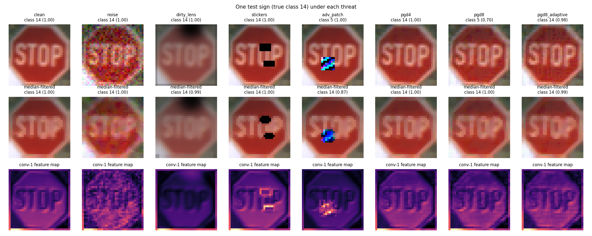

# Traffic-sign classifier under corruption and attack (GTSRB)

Trained on 23,976 images (7.9 min, CPU); clean accuracy on all 12,630 test images: **98.4%**. Threats evaluated on 3,000 random test images.

## Accuracy by threat and defence

| Threat | none | median | jpeg | lowpass | Flagged by integrity score |
|---|---|---|---|---|---|
| clean | 98.4% | 97.9% | 97.4% | 98.3% | 10.3% |
| noise | 89.5% | 91.2% | 86.2% | 90.5% | 29.5% |
| dirty_lens | 82.5% | 77.6% | 73.5% | 82.0% | 49.2% |
| stickers | 76.0% | 72.9% | 71.3% | 74.4% | 50.2% |
| adv_patch | 61.6% | 75.8% | 68.8% | 68.3% | 54.7% |
| pgd4 | 41.2% | 56.1% | 59.7% | 48.9% | 51.5% |
| pgd8 | 14.8% | 30.6% | 31.1% | 22.4% | 39.2% |
| pgd8_adaptive | - | 25.8% | - | - | 31.1% |

Integrity threshold 0.009 (5% false alarms on clean validation images). Inference 0.65 ms per image on CPU.

